# Standard basis benches with aligned buffers

## Main RS codec methods

### `Codec::encode_systematic_sharded`

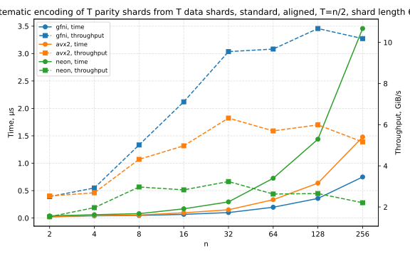
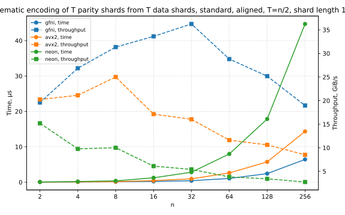
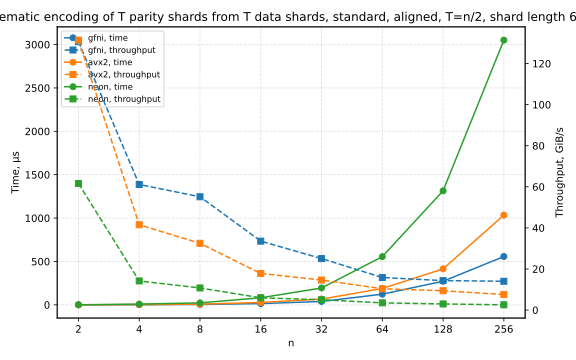

### `Codec::recover_erasures_sharded_clobber`

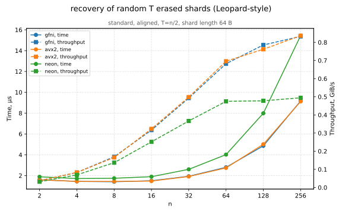
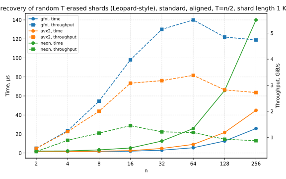
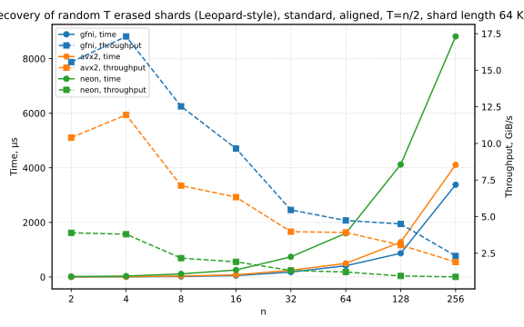

### `Codec::recover_erasures_sharded`

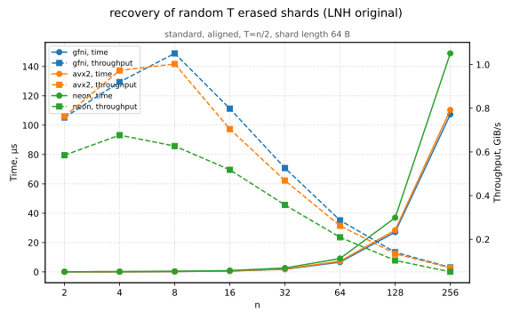

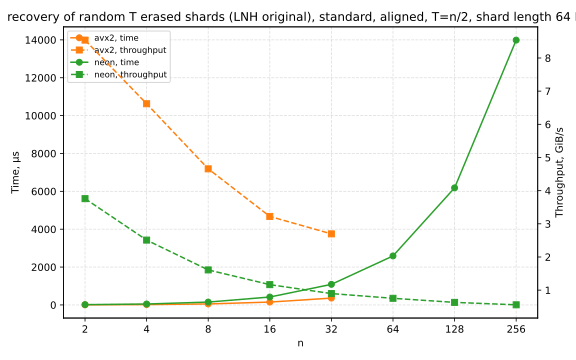

## Transforms

### `Kernel::fft_sharded`

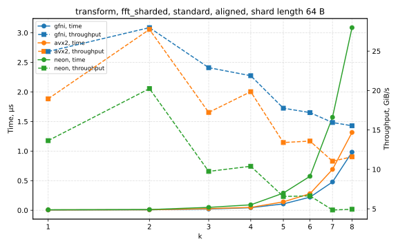
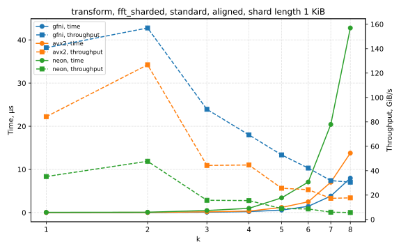
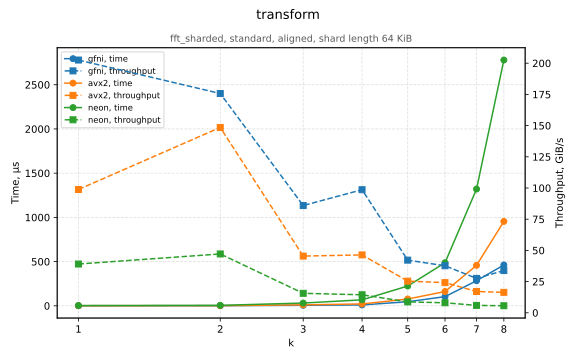

### `Kernel::fft_sharded_dit2`

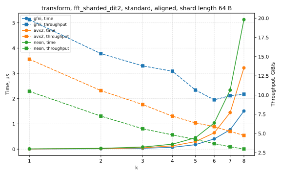
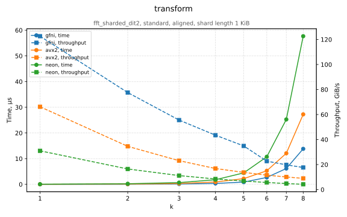
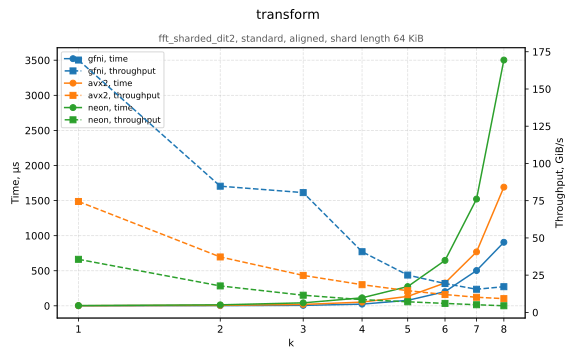

### `Kernel::fft_sharded_dit4`

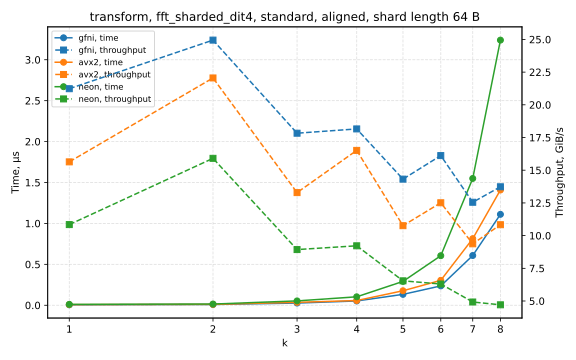
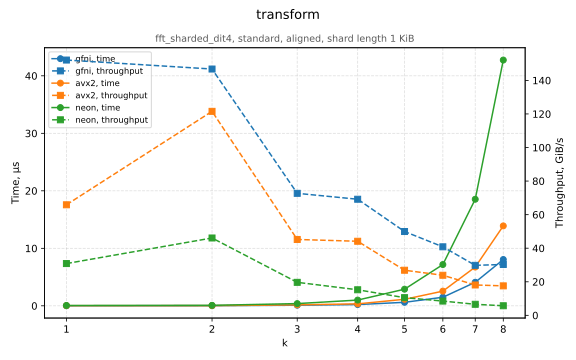
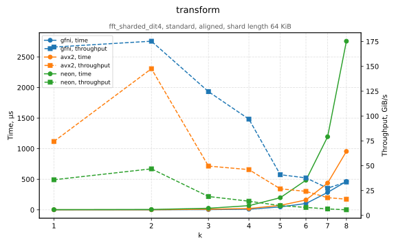

### `Kernel::fft_sharded_radix2_last`

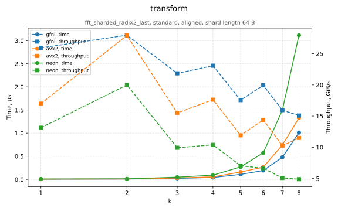
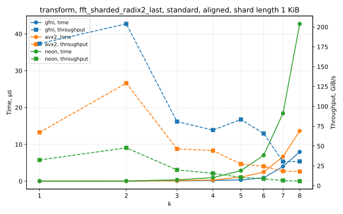
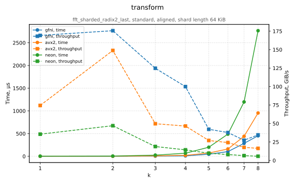

### `Kernel::ifft_sharded`

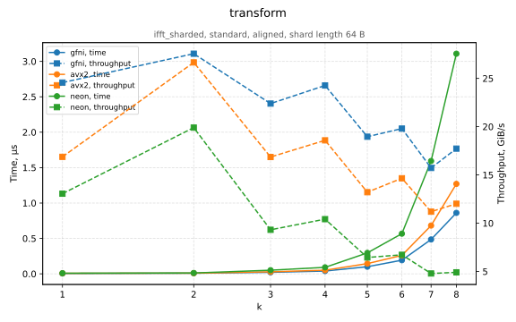
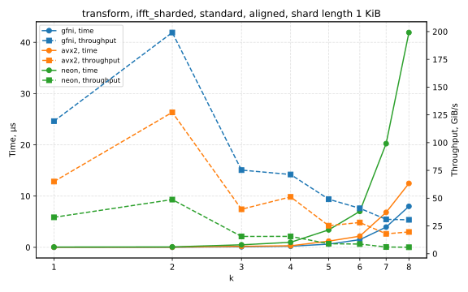
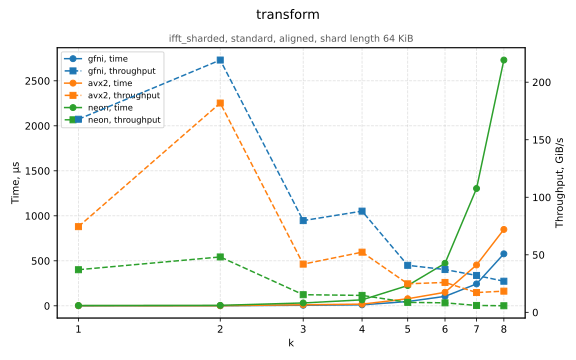

### `Kernel::ifft_sharded_dit2`

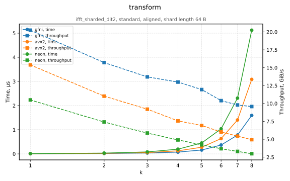
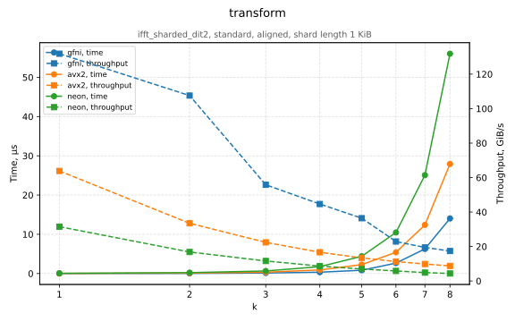
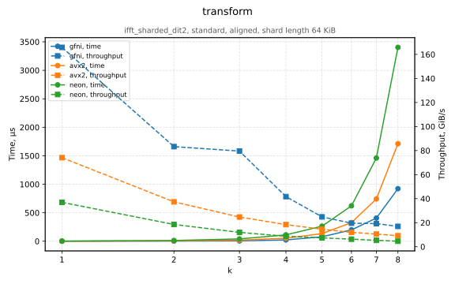

### `Kernel::ifft_sharded_dit4`

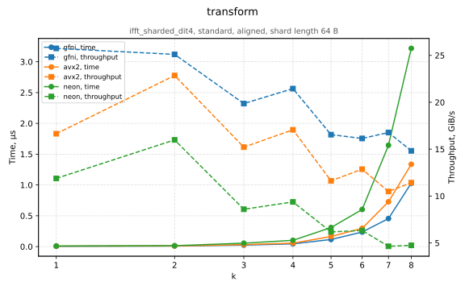
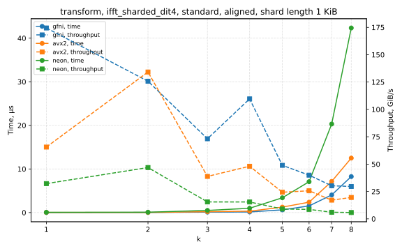
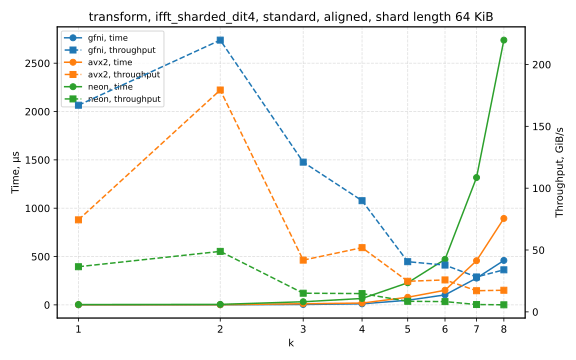
